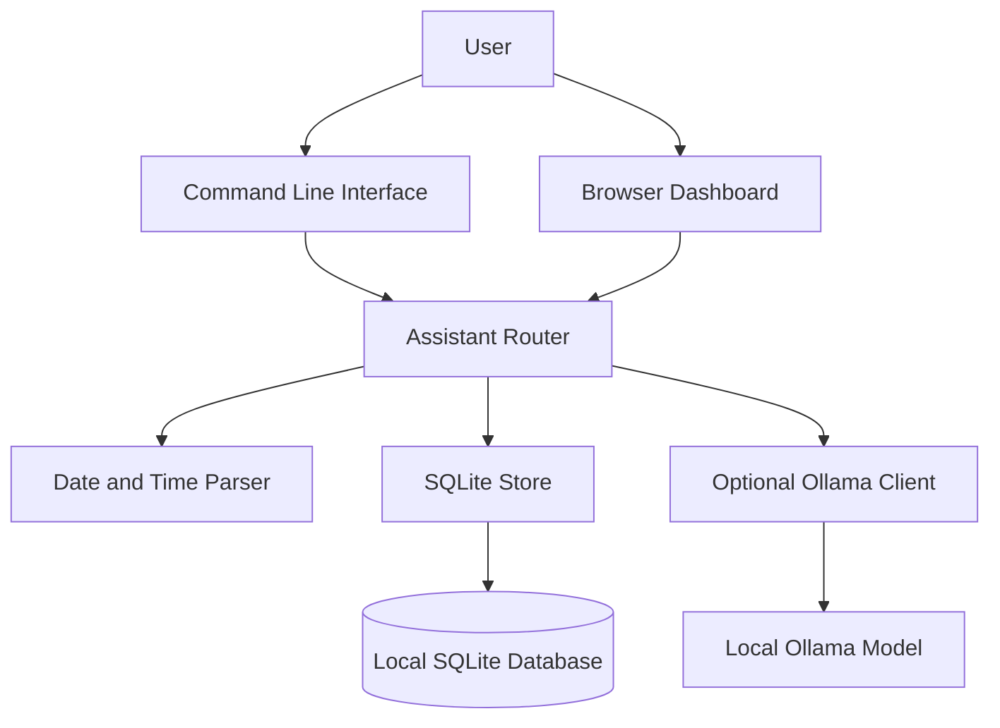

<div align="center">

# J.A.R.V.I.S.

### A private, local-first AI productivity assistant for your desktop.

J.A.R.V.I.S. is a Python desktop productivity assistant that brings notes, tasks, reminders, daily briefs, a browser-based command center, voice interaction, and optional local AI chat into one private workspace. It uses SQLite for local persistence and Ollama for optional on-device language-model conversations.

<p>
  <a href="https://ansh44233.github.io/jarvis-assistant/"><strong>▶ Try the interactive demo</strong></a>
  &nbsp;·&nbsp;
  <a href="https://github.com/ansh44233/jarvis-assistant">View source</a>
  &nbsp;·&nbsp;
  <a href="#-quick-start">Get started</a>
</p>

<p>
  <a href="https://github.com/ansh44233/jarvis-assistant/actions/workflows/ci.yml"></a>
  <a href="https://github.com/ansh44233/jarvis-assistant/actions/workflows/pages.yml"></a>
  
  
  
  <a href="LICENSE"></a>
  <a href="https://github.com/ansh44233/jarvis-assistant/stargazers"></a>
</p>

</div>

---

## ✨ What is J.A.R.V.I.S.?

J.A.R.V.I.S. is a lightweight personal productivity assistant built around one principle: **your everyday workspace should stay useful, understandable, and under your control.**

It combines a command-line interface with a browser dashboard. Save notes, organize tasks, schedule reminders, review a daily brief, and optionally chat with a model running locally through [Ollama](https://ollama.com/).

The core application uses Python's standard library and SQLite. No hosted AI account is required for its core productivity features.

 > **Try before installing:** [Open the public JARVIS demo](https://ansh44233.github.io/jarvis-assistant/). It includes live conversational AI through a separately deployed Cloudflare Worker, browser speech input/output, and a temporary sample workspace. It does not connect to your personal JARVIS database.

## 🚀 Highlights

| Feature | What it offers |
|---|---|
| 📝 Notes | Save, list, search, and delete notes |
| ✅ Tasks | Create tasks, add due dates, list open work, and mark tasks complete |
| ⏰ Reminders | Schedule one-time, daily, and weekly reminders |
| ☀️ Daily brief | Review overdue and upcoming work at a glance |
| 🖥️ Browser dashboard | Responsive dark dashboard with quick actions and workspace counters |
| 🤖 Optional local AI | Chat through an Ollama model running on your machine |
| 🎙️ Browser voice input | Speech recognition where supported by the browser |
| 🔊 Spoken replies | Optional browser speech synthesis |
| 💾 Local persistence | Store notes, tasks, reminders, and recent chat history in SQLite |
| 📦 JSON export | Export your workspace to a portable JSON file |
| 🧪 Automated tests | Run the test suite locally and through GitHub Actions |

### Why local-first?

- **Your data stays yours:** the database is stored on your device.
- **No mandatory AI service:** AI chat is optional; the core organizer works without it.
- **Small runtime footprint:** no third-party Python runtime dependencies for core features.
- **Understandable code:** a compact Python codebase with separate modules for routing, storage, date parsing, AI, and the dashboard.

## 🧭 Live demo

**[Launch the J.A.R.V.I.S. interactive demo →](https://ansh44233.github.io/jarvis-assistant/)**

The public demo is intentionally separate from the desktop application. It can answer natural-language questions through Cloudflare Workers AI, use browser speech input/output, and simulate notes, tasks, reminders, and the daily brief in the browser. The demo does not access a visitor's local database, private files, or desktop controls. Its sample workspace is temporary.

To try it, enter `help`, then test commands such as:

```text
note Explore Python automation
task Finish portfolio tomorrow
remind me to take a break in 30 minutes
brief
notes
tasks
```

The full Python dashboard is different: it runs on your own machine at `http://127.0.0.1:8765` and can use your locally installed Ollama model.

## 🧰 Tech stack

- **Language:** Python 3.10+
- **Persistence:** SQLite
- **Web interface:** HTML, CSS, vanilla JavaScript, Python standard-library HTTP server
- **Optional AI:** Ollama local HTTP API
- **Automation:** GitHub Actions
- **Public demo hosting:** GitHub Pages + Cloudflare Workers AI

## ⚡ Quick start

### Requirements

- Python **3.10 or newer**
- Git
- Ollama only if you want optional local AI chat

### 1. Clone the project

```bash
git clone https://github.com/ansh44233/jarvis-assistant.git
cd jarvis-assistant
```

### 2. Create a virtual environment

**Windows (PowerShell):**

```powershell
python -m venv .venv
.venv\Scripts\Activate.ps1
```

**macOS / Linux:**

```bash
python3 -m venv .venv
source .venv/bin/activate
```

### 3. Install

```bash
python -m pip install --upgrade pip
python -m pip install -e .
```

The core application has no third-party runtime dependencies.

### 4. Run J.A.R.V.I.S.

Start the interactive terminal assistant:

```bash
jarvis
```

Run a single command:

```bash
jarvis "note Explore Python automation"
jarvis tasks
```

Launch the browser dashboard:

```bash
jarvis --web
```

Then open **http://127.0.0.1:8765** in your browser.

## 🖥️ Browser dashboard

The built-in dashboard provides:

- A command console for interacting with J.A.R.V.I.S.
- Workspace counters for notes, open tasks, reminders, and chat history
- Quick actions for common commands
- Browser speech input where supported
- Optional spoken replies using browser speech synthesis

The dashboard is served by the local Python application. By default, it binds to `127.0.0.1`, so it is reachable only from your own computer.

## 🤖 Optional local AI with Ollama

AI chat is optional. J.A.R.V.I.S. can send prompts to an Ollama server that you run and configure locally.

1. Install [Ollama](https://ollama.com/).
2. Start Ollama and download a model that your computer can run.
3. For example, pull `qwen2.5:3b`.
4. Start J.A.R.V.I.S. and enter a command such as:

```text
chat Explain recursion with a simple example
```

If Ollama is unavailable, notes, tasks, reminders, the daily brief, export, and the browser dashboard remain usable.

## ⌨️ Command reference

| Command | Description | Example |
|---|---|---|
| `note <text>` | Save a note | `note Read about Python decorators` |
| `notes` | List saved notes | `notes` |
| `find <word>` | Search notes | `find Python` |
| `task <text> [when]` | Create a task with an optional due date | `task Finish assignment tomorrow` |
| `tasks` | List open tasks | `tasks` |
| `done <id>` | Mark a task complete | `done 2` |
| `remind me <text> <when>` | Create a reminder | `remind me to stretch in 30 minutes` |
| `reminders` | List pending reminders | `reminders` |
| `brief` | Show your daily brief | `brief` |
| `chat <message>` | Ask the local AI model | `chat Summarize this idea` |
| `delete note <id>` | Delete a note | `delete note 1` |
| `delete task <id>` | Delete a task | `delete task 2` |
| `delete reminder <id>` | Delete a reminder | `delete reminder 3` |
| `help` | Show command help | `help` |
| `quit` | Exit interactive mode | `quit` |

Commands are handled by J.A.R.V.I.S.'s intent router. It does not execute arbitrary shell commands from chat.

## 📅 Dates and recurring reminders

The date parser supports relative days, weekdays, explicit dates, 12/24-hour times, relative durations, and daily or weekly repeats.

```text
task Submit the project tomorrow
task Prepare presentation friday at 6pm
remind me to take a break in 45 minutes
remind me to review my notes every day at 9pm
remind me to call home every sunday at 8pm
```

Date-only reminders are scheduled for **9:00 AM**. Invalid calendar dates and out-of-range clock times are rejected.

## ⚙️ Configuration

| Environment variable | Default | Purpose |
|---|---|---|
| `JARVIS_DB` | `~/.jarvis/jarvis.db` | SQLite database path |
| `JARVIS_NAME` | `boss` | Name shown in the daily brief |
| `JARVIS_OLLAMA_URL` | `http://127.0.0.1:11434` | Ollama server endpoint |
| `JARVIS_MODEL` | `qwen2.5:3b` | Model used for AI chat |

You can also choose a database path with the CLI's `--db` option.

## 🏗️ Architecture

The application keeps its main responsibilities separated:



| Module | Responsibility |
|---|---|
| `assistant.py` | Routes commands and coordinates features |
| `cli.py` | CLI entry point and dashboard launcher |
| `timeparse.py` | Parses dates, times, and recurring reminders |
| `store.py` | SQLite persistence and data export |
| `ai.py` | Optional Ollama integration |
| `web.py` | Local browser dashboard and HTTP endpoints |

### Repository layout

```text
jarvis-assistant/
├── .github/
│   └── workflows/
│       ├── ci.yml
│       └── pages.yml
├── demo/
│   └── index.html
├── jarvis/
│   ├── __init__.py
│   ├── __main__.py
│   ├── ai.py
│   ├── assistant.py
│   ├── cli.py
│   ├── store.py
│   ├── timeparse.py
│   └── web.py
├── tests/
├── LICENSE
├── pyproject.toml
└── README.md
```

## 🔐 Privacy and security

- Notes, tasks, reminders, and conversation history are stored in a local SQLite database.
- On POSIX systems, J.A.R.V.I.S. restricts the database file to owner-only read/write permissions when created or opened.
- Core productivity features do not need an internet connection after installation.
- Optional AI prompts are sent to the Ollama endpoint you configure.
- The local dashboard binds to localhost by default and does **not** include authentication.
- Database files and JSON exports may contain personal information; do not commit them to a public repository.

**Do not expose the local Python dashboard directly to the public internet.** It is designed for personal localhost use, not as a multi-user hosted service. The public GitHub Pages demo is a separate simulation with sample data.

## 🧪 Development and testing

Run the test suite from the repository root:

```bash
python -m unittest discover -s tests -t . -v
```

Compile the application and tests:

```bash
python -m compileall -q jarvis tests
```

The tests cover command handling, task and reminder behavior, date parsing, SQLite persistence, and the Ollama client. AI client tests use mocked HTTP responses, so Ollama is not required to run the test suite.

GitHub Actions runs the test suite across Python 3.10, 3.11, 3.12, and 3.13.

## 🌐 Hosting the public AI demo

The frontend is hosted on GitHub Pages. Natural conversation is handled by a separate Cloudflare Worker so that no AI credentials or private keys are placed in browser JavaScript.

### Deploy the AI backend

Requirements: a Cloudflare account, Node.js, and npm.

1. Clone this repository and open a terminal in the `worker/` directory.
2. Authenticate Wrangler with your Cloudflare account:

   ```bash
   npx wrangler login
   ```

3. Deploy the Worker:

   ```bash
   npx wrangler deploy
   ```

4. Copy the deployed `https://<worker-name>.<your-subdomain>.workers.dev` URL.
5. In `demo/index.html`, replace the `API_URL` placeholder with that exact Worker URL and commit the change.
6. GitHub Actions will publish the updated frontend to GitHub Pages.

The Worker uses the native Cloudflare Workers AI binding configured in `worker/wrangler.toml` and the `@cf/meta/llama-3.1-8b-instruct` model. Cloudflare account setup and AI usage limits or charges may apply; check the current Cloudflare Workers AI pricing before enabling the public endpoint. The Worker accepts requests only from this project's GitHub Pages origin, validates message size, limits conversation history sent to the model, and does not store chat transcripts.

### Demo boundaries

- AI chat requires the Cloudflare Worker to be deployed and its URL configured in the frontend.
- Voice input/output uses browser speech features and requires a compatible browser and microphone permission.
- Notes, tasks, and reminders in the public demo are temporary browser-side sample data; they are not synchronized with the local Python app.
- The local Python dashboard and its Ollama integration remain independent of the public demo.

The workflow at `.github/workflows/pages.yml` deploys the `demo/` folder to GitHub Pages whenever the demo or workflow changes on `main`.

Public URL: **https://ansh44233.github.io/jarvis-assistant/**

## ⭐ Star History

If you find the project useful, consider giving it a star. It helps others discover the repository.

[](https://star-history.com/#ansh44233/jarvis-assistant&Date)

## ✅ Project status

The current student-project scope is implemented: terminal and browser interfaces, local SQLite persistence, notes, tasks, reminders, daily brief, JSON export, natural-language chat routing through the optional Ollama integration, browser speech input/output where supported, a public interactive demo, and automated tests.

The project is suitable as a portfolio demonstration of Python application design, CLI development, local data persistence, HTTP/API integration, frontend implementation, testing, and GitHub Actions automation.

### Known boundaries

- AI conversations require Ollama to be installed and running locally; the core organizer works without it.
- Browser speech recognition depends on browser support and microphone permission.
- The GitHub Pages demo uses sample data and simulates the product; it is not connected to a user's local database or AI model.
- The local dashboard is intended for localhost use and does not include authentication. Do not expose it directly to the public internet.
- This is a student portfolio project, not a security-audited or multi-user production service.

Future enhancements can build on this stable, defined feature set; they are not required to use the current application.

## 🤝 Contributing

Contributions, bug reports, and thoughtful suggestions are welcome.

1. Fork the repository.
2. Create a feature branch.
3. Make a focused change and add or update tests.
4. Run `python -m unittest discover -s tests -t .`.
5. Open a pull request describing the change and how you tested it.

## 📄 License

J.A.R.V.I.S. is released under the [MIT License](LICENSE).

---

<div align="center">

**Built to keep everyday productivity simple, understandable, and local-first.**

[Interactive demo](https://ansh44233.github.io/jarvis-assistant/) · [GitHub repository](https://github.com/ansh44233/jarvis-assistant) · [Star history](https://star-history.com/#ansh44233/jarvis-assistant&Date)

</div>
