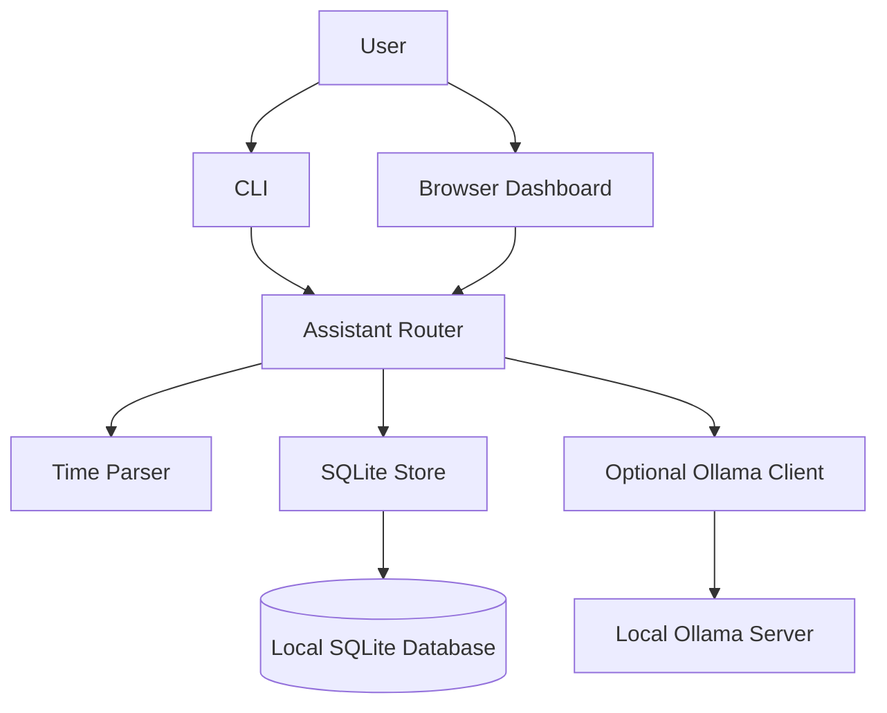

<div align="center">

# J.A.R.V.I.S.

### Your personal command center. Private, lightweight, and local-first.

A Python productivity assistant for managing notes, tasks, reminders, and optional local AI conversations — from your terminal or a browser dashboard.

<p>
  <a href="https://github.com/ansh44233/jarvis-assistant/actions/workflows/ci.yml"></a>
  
  
  
  
</p>

[Features](#-features) · [Quick start](#-quick-start) · [Commands](#-command-reference) · [Architecture](#-architecture) · [Configuration](#-configuration)

</div>

---

## Overview

J.A.R.V.I.S. is a lightweight personal productivity assistant built around a simple idea: everyday organization should be fast, useful, and under your control.

Use the command-line interface for quick actions or launch the browser dashboard for a visual command center. Notes, tasks, reminders, and conversation history are stored in a local SQLite database. When you want conversational AI, JARVIS can optionally connect to an Ollama model running on your machine.

**The core application does not require third-party Python packages or a hosted AI API.**

## Table of contents

- [Features](#-features)
- [Quick start](#-quick-start)
- [Browser dashboard](#-browser-dashboard)
- [Optional local AI](#-optional-local-ai)
- [Command reference](#-command-reference)
- [Date and reminder syntax](#-date-and-reminder-syntax)
- [Configuration](#-configuration)
- [Data and privacy](#-data-and-privacy)
- [Architecture](#-architecture)
- [Project structure](#-project-structure)
- [Development and testing](#-development-and-testing)
- [Roadmap](#-roadmap)
- [Contributing](#-contributing)
- [License](#-license)

## ✨ Features

| Capability | What it does |
|---|---|
| **Notes** | Save, list, search, and delete personal notes |
| **Tasks** | Create tasks with optional due dates, list open tasks, and mark tasks complete |
| **Reminders** | Schedule one-time reminders or recurring daily and weekly reminders |
| **Daily brief** | Get a quick overview of overdue or upcoming work |
| **Local persistence** | Store notes, tasks, reminders, and recent chat history in SQLite |
| **Browser dashboard** | Use a responsive dark interface with quick actions and workspace counters |
| **Optional AI chat** | Connect to a locally running Ollama model |
| **Voice input** | Use browser speech recognition where the browser supports it |
| **JSON export** | Export stored data to a portable JSON file |
| **Automated tests** | Run the test suite in CI across Python 3.10–3.13 |

### Why JARVIS?

- **Local-first by default:** your productivity data is stored on your device.
- **Lightweight:** the core CLI and dashboard use the Python standard library.
- **Flexible:** use the terminal, browser dashboard, or optional local AI chat.
- **Transparent:** predictable commands and a small codebase make the application easy to understand and extend.

## 🚀 Quick start

### Requirements

- Python **3.10 or newer**
- Git
- Ollama only if you want to use the optional AI chat feature

### 1. Clone the repository

```bash
git clone https://github.com/ansh44233/jarvis-assistant.git
cd jarvis-assistant
```

### 2. Create and activate a virtual environment

**Windows (PowerShell):**

```powershell
python -m venv .venv
.venv\Scripts\Activate.ps1
```

**macOS / Linux:**

```bash
python3 -m venv .venv
source .venv/bin/activate
```

### 3. Install JARVIS

```bash
python -m pip install -e .
```

The core application has no third-party runtime dependencies.

### 4. Start the assistant

```bash
jarvis
```

You should see a daily brief followed by the interactive `jarvis>` prompt. Type `help` to view available commands, or `quit` to exit.

You can also run a single command directly:

```bash
jarvis "note Explore Python automation"
jarvis tasks
```

## 🖥️ Browser dashboard

JARVIS includes a built-in browser dashboard served by the local Python application.

Start it with:

```bash
jarvis --web
```

Then open `http://127.0.0.1:8765`.

The dashboard includes a command console, workspace counters, quick actions, browser voice input where supported, and optional spoken replies using browser speech synthesis.

The server binds to `127.0.0.1` by default, keeping it accessible only from your own machine.

## 🤖 Optional local AI

AI chat is an optional feature powered by [Ollama](https://ollama.com/). JARVIS sends prompts to the Ollama endpoint you configure; it does not require a hosted AI API.

1. Install and start Ollama.
2. Pull a model your computer can run, for example `ollama pull qwen2.5:3b`.
3. Start JARVIS and use `chat Explain recursion with a simple example`.

If Ollama is unavailable, notes, tasks, reminders, export, and dashboard features remain usable.

## ⌨️ Command reference

| Command | Description | Example |
|---|---|---|
| `note <text>` | Save a note | `note Read about Python decorators` |
| `notes` | List saved notes | `notes` |
| `find <word>` | Search notes | `find Python` |
| `task <text> [when]` | Create a task with optional due date | `task Finish assignment tomorrow` |
| `tasks` | List open tasks | `tasks` |
| `done <id>` | Mark a task complete | `done 2` |
| `remind me <text> <when>` | Create a reminder | `remind me to stretch in 30 minutes` |
| `reminders` | List pending reminders | `reminders` |
| `brief` | Show your daily brief | `brief` |
| `chat <message>` | Ask the local AI model | `chat Summarize this idea` |
| `delete note <id>` | Delete a note | `delete note 1` |
| `delete task <id>` | Delete a task | `delete task 2` |
| `delete reminder <id>` | Delete a reminder | `delete reminder 3` |
| `help` | Show command help | `help` |
| `quit` | Exit interactive mode | `quit` |

Commands are handled by JARVIS's own intent router. It does not execute arbitrary shell commands from chat.

## 📅 Date and reminder syntax

JARVIS understands relative days, weekdays, explicit dates, 12/24-hour times, relative durations, and daily or weekly repeats.

```text
task Submit the project tomorrow
task Prepare presentation friday at 6pm
remind me to take a break in 45 minutes
remind me to review my notes every day at 9pm
remind me to call home every sunday at 8pm
```

Date-only reminders are scheduled for **9:00 AM**. Invalid calendar dates and out-of-range clock times are rejected.

## ⚙️ Configuration

| Variable | Default | Description |
|---|---|---|
| `JARVIS_DB` | `~/.jarvis/jarvis.db` | Path to the SQLite database |
| `JARVIS_NAME` | `boss` | Name displayed in the daily brief |
| `JARVIS_OLLAMA_URL` | `http://127.0.0.1:11434` | Ollama server endpoint |
| `JARVIS_MODEL` | `qwen2.5:3b` | Ollama model used for chat |

The database location can also be set with the CLI's `--db` option.

## 🔐 Data and privacy

- Notes, tasks, reminders, and conversation history are stored in SQLite on your device.
- On POSIX systems, JARVIS restricts the database file to owner-only read/write permissions when created or opened.
- Core productivity features do not need an internet connection after installation.
- Optional AI prompts are sent to the Ollama endpoint you configure.
- The dashboard binds to localhost by default and does not include authentication.
- JSON exports and the SQLite database may contain personal information; do not commit them to a public repository.

**Deployment note:** the dashboard is intended for localhost use. Do not expose it to a public network unless you add appropriate authentication and understand the security implications.

## 🧩 Architecture



| Module | Responsibility |
|---|---|
| `assistant.py` | Routes commands and coordinates application features |
| `cli.py` | Command-line interface and dashboard launcher |
| `timeparse.py` | Parses dates, times, and recurring reminders |
| `store.py` | SQLite persistence |
| `ai.py` | Optional Ollama integration |
| `web.py` | Local browser dashboard server |

## 📁 Project structure

```text
jarvis-assistant/
├── .github/workflows/ci.yml
├── jarvis/
│   ├── __init__.py
│   ├── __main__.py
│   ├── assistant.py
│   ├── ai.py
│   ├── cli.py
│   ├── store.py
│   ├── timeparse.py
│   └── web.py
├── tests/
├── LICENSE
├── pyproject.toml
└── README.md
```

## 🧪 Development and testing

Run the test suite:

```bash
python -m unittest discover -s tests -t .
```

The tests cover command handling, task and reminder behavior, date parsing, SQLite persistence, and the Ollama client. AI client tests use a mocked HTTP response, so Ollama is not required to run the suite.

GitHub Actions is configured for Python 3.10–3.13.

## 🗺️ Roadmap

- [ ] More flexible natural-language command parsing.
- [ ] Dashboard improvements and richer task views.
- [ ] Additional export and backup options.
- [ ] More configurable assistant preferences.
- [ ] Expanded test coverage and developer documentation.

These are potential directions, not features currently included.

## 🤝 Contributing

1. Fork the repository.
2. Create a feature branch.
3. Make changes and add or update tests.
4. Run `python -m unittest discover -s tests -t .`.
5. Open a pull request with a clear description.

## 📄 License

This project is licensed under the [MIT License](LICENSE).
