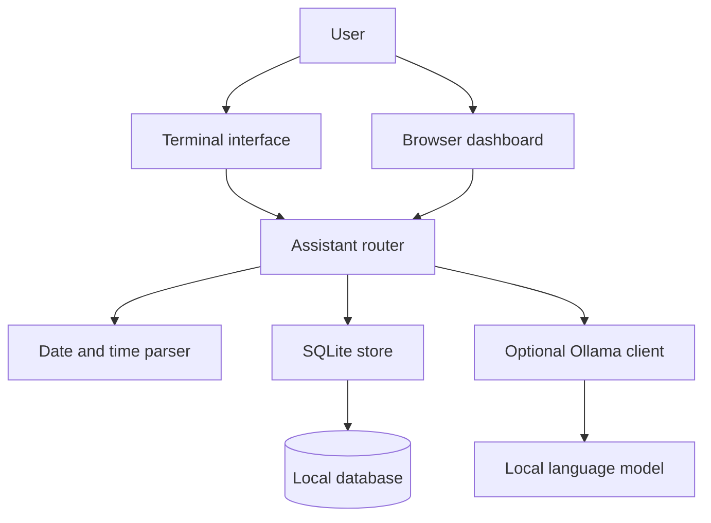
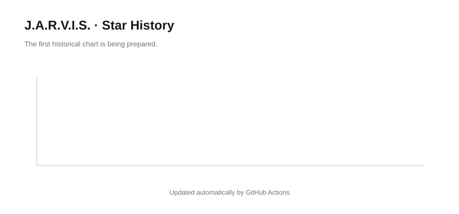

<div align="center">

# J.A.R.V.I.S.

### A personal AI assistant built with Python.

**I’m Ansh, and I built J.A.R.V.I.S. to bring everyday productivity tools and an AI-powered conversation interface into one focused workspace.**

<p>
  <a href="https://github.com/ansh44233/jarvis-assistant">Source code</a>
  &nbsp;·&nbsp;
  <a href="#quick-start">Get started</a>
  &nbsp;·&nbsp;
  <a href="#features">Features</a>
</p>

<p>
  <a href="https://github.com/ansh44233/jarvis-assistant/actions/workflows/ci.yml"></a>
  
  
  
  <a href="LICENSE"></a>
</p>

</div>

---

## About the project

J.A.R.V.I.S. is a local-first productivity assistant that I designed and developed as a hands-on Python project. It combines a terminal interface, a browser-based dashboard, structured personal data, and optional local language-model conversations.

The goal was to build more than a basic chatbot: I wanted one application where I could capture information, manage everyday work, review what needs attention, and talk to a locally running AI model without making a hosted AI service mandatory.

## Features

| Area | What I implemented |
|---|---|
| **AI conversation** | Natural-language chat through an optional Ollama model running locally |
| **Command routing** | Plain-language messages and dedicated productivity commands |
| **Notes** | Create, list, search, and delete notes |
| **Tasks** | Add tasks, set due dates, list open work, and mark tasks complete |
| **Reminders** | One-time, daily, and weekly reminders with date/time parsing |
| **Daily brief** | A summary of due work, reminders, and open tasks |
| **Browser dashboard** | Responsive dark interface with conversation, quick actions, and workspace counters |
| **Voice interface** | Browser speech recognition and spoken replies where supported |
| **Local storage** | SQLite persistence for notes, tasks, reminders, and recent chat history |
| **Data export** | Export workspace data as JSON |
| **Automated tests** | Unit tests and a multi-version Python CI workflow |

## Tech stack

- **Python 3.10+** — application logic and CLI
- **SQLite** — local structured storage
- **HTML, CSS, JavaScript** — browser dashboard
- **Ollama** — optional local AI inference through its HTTP API
- **GitHub Actions** — automated testing and repository workflows

## Quick start

### Requirements

- Python 3.10 or newer
- Git
- Ollama only if you want AI conversation

### 1. Clone the repository

```bash
git clone https://github.com/ansh44233/jarvis-assistant.git
cd jarvis-assistant
```

### 2. Create and activate a virtual environment

**Windows PowerShell**

```powershell
python -m venv .venv
.venv\Scripts\Activate.ps1
```

**macOS / Linux**

```bash
python3 -m venv .venv
source .venv/bin/activate
```

### 3. Install the project

```bash
python -m pip install --upgrade pip
python -m pip install -e .
```

The core application uses Python's standard library; Ollama is an optional separate application for AI chat.

### 4. Run J.A.R.V.I.S.

Start the terminal assistant:

```bash
jarvis
```

Start the browser dashboard:

```bash
jarvis --web
```

Then open `http://127.0.0.1:8765`.

## AI setup

J.A.R.V.I.S. can use a model hosted by your own Ollama installation. This keeps inference on your machine and avoids making a remote AI account a requirement for the productivity features.

1. Install and start [Ollama](https://ollama.com/).
2. Download a model supported by your computer. The default configured model is `qwen2.5:3b`.
3. Start J.A.R.V.I.S. and send a normal message or use the `chat` command.

For example:

```text
Hi JARVIS, how are you?
chat Explain recursion with a simple example
```

If Ollama is not running, the notes, tasks, reminders, daily brief, and export features remain available. AI chat itself needs the local model.

## Command reference

| Command | Purpose | Example |
|---|---|---|
| `note <text>` | Save a note | `note Read about Python decorators` |
| `notes` | List notes | `notes` |
| `find <word>` | Search notes | `find Python` |
| `task <text> [when]` | Add a task | `task Finish assignment tomorrow` |
| `tasks` | List open tasks | `tasks` |
| `done <id>` | Complete a task | `done 2` |
| `remind me <text> <when>` | Create a reminder | `remind me to stretch in 30 minutes` |
| `reminders` | List reminders | `reminders` |
| `brief` | Show today's brief | `brief` |
| `chat <message>` | Ask the local AI model | `chat Summarize this idea` |
| `delete note <id>` | Delete a note | `delete note 1` |
| `delete task <id>` | Delete a task | `delete task 2` |
| `delete reminder <id>` | Delete a reminder | `delete reminder 3` |
| `help` | Show available commands | `help` |

Date parsing supports relative dates, weekdays, explicit dates, clock times, relative durations, and daily or weekly repeats.

## How it is structured



| Module | Responsibility |
|---|---|
| `assistant.py` | Routes messages and coordinates features |
| `cli.py` | Terminal entry point and dashboard launcher |
| `timeparse.py` | Parses dates, times, and recurring reminders |
| `store.py` | SQLite persistence and JSON export |
| `ai.py` | Optional Ollama integration |
| `web.py` | Local dashboard and HTTP endpoints |

## Testing

Run the complete test suite:

```bash
python -m unittest discover -s tests -t . -v
```

Compile the source and tests:

```bash
python -m compileall -q jarvis tests
```

GitHub Actions runs the test suite on Python 3.10, 3.11, 3.12, and 3.13.

## Privacy and current limitations

- Notes, tasks, reminders, and recent conversation history are stored in a local SQLite database.
- The optional AI client sends prompts to the Ollama endpoint configured on your computer.
- Browser speech input and output depend on browser support and microphone permissions.
- The local dashboard binds to `127.0.0.1` by default and does not include authentication. It is intended for personal local use, not direct public exposure.
- This is a personal portfolio project and has not been security-audited for multi-user production use.

## Star history

<picture>
  <source media="(prefers-color-scheme: dark)" srcset="assets/star-history-dark.svg">
  
</picture>

The chart is generated in this repository's own GitHub Actions workflow and refreshed weekly.

---

<div align="center">

**Built by Ansh.**

A personal project exploring Python, local AI, voice interfaces, and practical productivity software.

</div>
