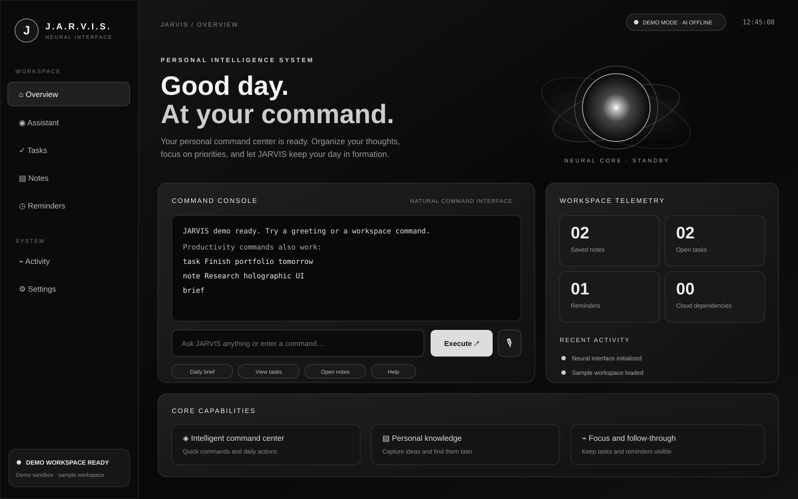
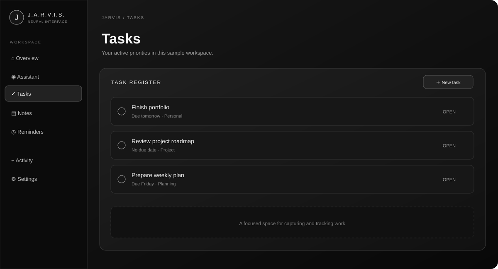
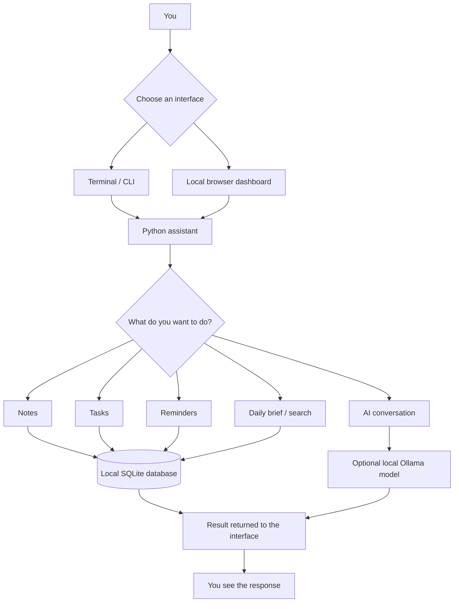
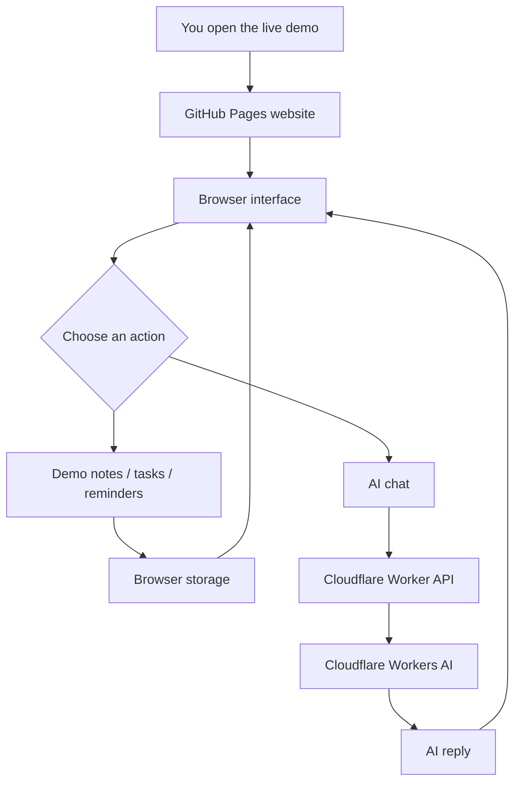

<div align="center">

# J.A.R.V.I.S.

### A personal AI-powered productivity assistant — built to grow.

**One workspace for notes, tasks, reminders, daily planning and AI-powered conversation.**

[**Launch Live Demo**](https://ansh44233.github.io/jarvis-assistant/) · [**Explore the Code**](https://github.com/ansh44233/jarvis-assistant) · [**Report a Bug**](https://github.com/ansh44233/jarvis-assistant/issues)

<br/>


</div>

---

## ✨ What is J.A.R.V.I.S.?

J.A.R.V.I.S. is a local-first personal productivity assistant designed to bring everyday organisation and AI interaction into one place.

The project currently combines a Python application, a browser-based dashboard, persistent local storage, and optional AI chat. It is being developed as a foundation for a more capable personal desktop assistant over time.

The goal is simple: make it easier to capture ideas, organise responsibilities, stay on top of reminders, and interact with an assistant through a clean interface.

> **Important:** J.A.R.V.I.S. is currently a productivity assistant and interactive demo — it is not yet a full Windows PC-control agent. Features such as launching desktop applications and controlling the operating system are future roadmap items, not current capabilities.

## 🖥️ Screenshots and interface previews

The visuals below are **illustrative previews based on the current demo interface**, not direct screenshots of a running session. They help show the layout and the main areas of the experience.

### Command Center



### Productivity workspace



[Open the live demo](https://ansh44233.github.io/jarvis-assistant/) to explore the actual interactive interface.

---

## 🚀 Try the live demo

<div align="center">

### [Open the J.A.R.V.I.S. Command Center →](https://ansh44233.github.io/jarvis-assistant/)

Explore the browser experience without installing anything.

</div>

The hosted demo is a separate web experience:
- Notes, tasks and reminders use sample workspace data stored in your browser.
- AI chat is handled by a separate Cloudflare Workers AI backend.
- Voice input and spoken replies depend on browser support and microphone permissions.
- The hosted website cannot access your computer, local files, local SQLite database, installed applications, or local Ollama instance.

For your own persistent local workspace, install and run the Python application using the instructions below.

## ✅ What works today

| Capability | Current implementation |
|---|---|
| Notes | Create, list, search and delete notes |
| Tasks | Create tasks, set due dates and mark tasks complete |
| Reminders | Create and review one-time and recurring reminders |
| Daily brief | Review upcoming and overdue work |
| Terminal assistant | Run commands from your local shell |
| Local dashboard | Open the Python app's browser dashboard |
| Local data storage | Store personal workspace data in SQLite |
| Optional local AI | Chat through an Ollama model |
| Public AI demo | Browser-based chat through Cloudflare Workers AI |
| Demo voice experience | Voice input and spoken replies in supported browsers |
| Data export | Export workspace data as JSON |

The local productivity features do not require an AI model. AI chat is an optional layer.

## 🧭 Two ways to use J.A.R.V.I.S.

### 1. Local Python application

Run J.A.R.V.I.S. on your own computer. The local application provides the terminal interface, browser dashboard, productivity commands and SQLite-backed storage. Optional AI chat can use an Ollama model running on your machine.

### 2. Hosted browser demo

Open the GitHub Pages website to explore the interface and sample workflows. Its demo data and AI backend are separate from the local Python application.

These experiences are related parts of the same project, but they do not currently share a live connection. Using the hosted demo does not give it control over your PC.

## 🛠️ Technology stack

| Technology | How it is used |
|---|---|
| **Python 3.10+** | Core application and command-line interface |
| **SQLite** | Local structured data storage |
| **HTML, CSS and JavaScript** | Browser dashboard and hosted demo |
| **Ollama** | Optional local language-model integration |
| **Cloudflare Workers AI** | AI chat backend for the public demo |
| **GitHub Pages** | Hosting the public demo |
| **GitHub Actions** | Automated checks and deployment workflows |

The core Python application is designed to run with the Python standard library; Ollama is optional for local AI chat.

## 🧩 How the project is organised

The repository is split into focused parts so that the local application, hosted demo, AI backend and tests can evolve independently.

```text
jarvis-assistant/
├── demo/                  # Public browser demo
├── jarvis/                # Local Python application
│   ├── ai.py              # Optional AI integration
│   ├── assistant.py       # Assistant and productivity logic
│   ├── cli.py             # Terminal commands
│   ├── store.py           # SQLite persistence
│   ├── timeparse.py       # Date and time parsing
│   └── web.py             # Local browser dashboard
├── worker/                # Cloudflare AI backend for the demo
├── tests/                 # Automated tests
├── .github/workflows/     # CI and deployment automation
├── LICENSE
├── README.md
└── pyproject.toml
```

## 🔄 How J.A.R.V.I.S. works

J.A.R.V.I.S. has two related experiences: the **local Python assistant** and the **hosted web demo**. They use separate data and AI paths, so the workflow depends on which version you open.

### Local assistant workflow

The local app receives a command through the terminal or local dashboard, processes the requested productivity action, and uses SQLite for persistent workspace data. AI chat is an optional path through the Ollama service configured on your computer.



### Hosted demo workflow

The public GitHub Pages demo runs in your browser. Its sample workspace data stays in browser storage, while AI chat is sent to the separate Cloudflare Workers AI backend. This hosted workflow does **not** connect to your PC, local database, installed apps or local Ollama instance.



### Workflow at a glance

| Step | Local application | Hosted demo |
|---|---|---|
| Interface | Terminal or local dashboard | GitHub Pages website |
| Productivity data | Local SQLite database | Browser sample data |
| AI chat | Optional Ollama integration | Cloudflare Workers AI |
| Access to your PC | Runs locally, but does not currently provide general PC control | No access to your PC |
| Best for | Using the local productivity tools | Trying the public interface and demo chat |

> **Current boundary:** A chat reply is not the same as an operating-system action. Opening desktop apps, controlling windows and executing arbitrary PC commands are not implemented yet; they remain future roadmap work.

---

## ⚡ Get started

### Requirements

- Python 3.10 or newer
- Windows, macOS or Linux
- Ollama only if you want optional local AI chat

### 1. Clone the repository

```bash
git clone https://github.com/ansh44233/jarvis-assistant.git
cd jarvis-assistant
```

### 2. Create and activate a virtual environment

**Windows PowerShell**

```powershell
python -m venv .venv
.venv\Scripts\Activate.ps1
```

**macOS / Linux**

```bash
python3 -m venv .venv
source .venv/bin/activate
```

### 3. Install J.A.R.V.I.S.

```bash
python -m pip install -e .
```

### 4. Start the assistant

Run the terminal interface:

```bash
jarvis
```

Or start the local browser dashboard:

```bash
jarvis --web
```

Then visit **http://127.0.0.1:8765** in your browser.

## 💬 Command reference

| Command | Description |
|---|---|
| `note <text>` | Save a note |
| `notes` | List saved notes |
| `find <word>` | Search notes |
| `task <text> [when]` | Create a task |
| `tasks` | List tasks |
| `done <id>` | Mark a task complete |
| `remind me <text> <when>` | Create a reminder |
| `reminders` | List reminders |
| `brief` | Display the daily brief |
| `chat <message>` | Chat with the configured local AI model |
| `delete note <id>` | Delete a note |
| `delete task <id>` | Delete a task |
| `delete reminder <id>` | Delete a reminder |
| `help` | Show available commands |

Example session:

```text
note Explore Python automation
task Finish my portfolio tomorrow
remind me to take a break in 30 minutes
brief
```

## 🧠 Optional local AI with Ollama

The core productivity features work without AI. To enable local AI chat:

1. Install [Ollama](https://ollama.com/).
2. Download a model:

   ```bash
   ollama pull qwen2.5:3b
   ```

3. Start J.A.R.V.I.S. and use the `chat <message>` command.

The model runs through your local Ollama installation. Model performance depends on your hardware and the model you choose.

The hosted demo uses a separate Cloudflare Workers AI backend. See [worker/README.md](worker/README.md) for its configuration and deployment notes.

## 🗺️ Roadmap — where J.A.R.V.I.S. is going

J.A.R.V.I.S. is an evolving project. The current release focuses on productivity fundamentals and a working browser demo. The following ideas describe the direction of future development; **they are planned, not implemented or guaranteed features yet.**

### Desktop assistant capabilities
- [ ] Build a secure local Windows agent that can receive approved commands from the assistant.
- [ ] Launch allowlisted desktop applications such as Edge, Discord and Notepad.
- [ ] Add configurable application shortcuts and user-approved desktop actions.
- [ ] Explore safe file and folder search, with clear permission boundaries.
- [ ] Package the local assistant into a simpler Windows installer.

### Voice and interaction
- [ ] Improve voice input and speech output across supported platforms.
- [ ] Explore optional wake-word activation.
- [ ] Add clearer listening, thinking and speaking states.
- [ ] Improve conversation history and context handling.

### Productivity and integrations
- [ ] Add calendar and schedule integrations.
- [ ] Expand task organisation, priorities, projects and filters.
- [ ] Add configurable notifications and reminder delivery.
- [ ] Explore integrations with other everyday productivity tools.

### Engineering and experience
- [ ] Expand automated and end-to-end test coverage.
- [ ] Improve accessibility, responsive layouts and customisation.
- [ ] Add setup diagnostics, logs and recovery guidance.
- [ ] Publish clearer architecture documentation and demo walkthroughs.

**The long-term vision:** grow J.A.R.V.I.S. from a useful productivity assistant into a reliable, permission-based personal desktop assistant — one carefully tested capability at a time.

## 🧪 Run the tests

From the repository root:

```bash
python -m unittest discover -s tests -t . -v
```

## 🔐 Privacy and security

- The local app stores its database at `~/.jarvis/jarvis.db` by default.
- Local AI prompts are sent to the Ollama server configured on your computer.
- The hosted demo uses browser storage for its sample workspace data.
- The public AI endpoint is separate from your local Python app and may consume your Cloudflare Workers AI quota.
- Do not expose the local dashboard directly to the public internet without adding appropriate authentication and security controls.
- Never commit API tokens, credentials or private configuration values to source control.

Future desktop-control features will need explicit permissions, an application allowlist and safe handling of commands. J.A.R.V.I.S. should never silently execute arbitrary instructions from a chat response.

## 🤝 Contributing and feedback

Ideas, bug reports and thoughtful contributions are welcome.

- [Open an issue](https://github.com/ansh44233/jarvis-assistant/issues)
- [Browse the source code](https://github.com/ansh44233/jarvis-assistant)

If you are suggesting a feature, please mention the problem it solves and the workflow you would expect.

## ⭐ Support the project

If J.A.R.V.I.S. is useful or interesting to you, consider giving the repository a star.

<div align="center">

[](https://star-history.com/#ansh44233/jarvis-assistant&Date)

</div>

---

<div align="center">

**Built with curiosity and a vision for a smarter personal workspace.**

Created by **Ansh** · [Live Demo](https://ansh44233.github.io/jarvis-assistant/) · [GitHub Repository](https://github.com/ansh44233/jarvis-assistant) · [MIT License](LICENSE)

</div>
